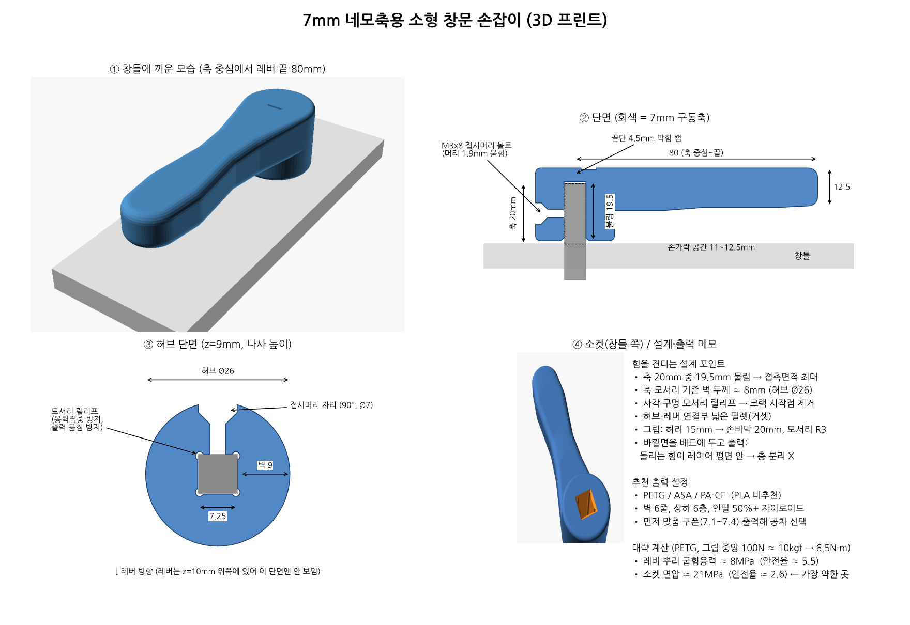

# 7mm 네모축용 소형 창문 손잡이 (3D 프린트)

LX하우시스 시스템창 등의 **7mm 사각 구동축**(창틀에서 20mm 돌출)에 끼워 쓰는 짧은 레버형 손잡이입니다.
원래 손잡이처럼 축을 돌려 창을 여닫고, 축 중심~레버 끝 80mm로 원래보다 짧지만 손 전체로 잡을 수 있는 길이입니다.
그립은 허리(15mm)에서 손바닥 부분(20mm)으로 넓어지고, 손에 닿는 모서리는 R3로 둥글렸습니다.



## 파일
| 파일 | 설명 |
|---|---|
| `window_handle_7mm.scad` | 파라미터 모델 (OpenSCAD) |
| `window_handle_7mm.stl` | 손잡이 출력용 (기본 공차 7.25mm) |
| `fit_test_coupon.stl` | 맞춤 테스트 쿠폰: 구멍 1=7.10, 2=7.20, 3=7.30, 4=7.40mm |
| `images/` | 렌더 이미지, 설계도 |
| `tools/make_sheet.py` | 설계도 이미지 생성 스크립트 |

## 사용 순서
1. `fit_test_coupon.stl` 출력 → 축에 **손으로 꽉 끼워지되 흔들림 없는** 구멍 번호 확인
2. 그 값에 맞춰 `fit_clear` 수정 (예: 3번이 맞으면 `fit_clear = 0.30`) 후 STL 다시 내보내기
3. 손잡이 출력: **바깥면(화살표 표시면)을 베드에** 놓고 출력 → 서포트 불필요
4. 축에 끼운 뒤 측면 구멍에 **M3x8 접시머리 볼트**(90°, 육각렌치형 ISO 10642 또는 십자형 ISO 7046)를 조여 축을 눌러 고정.
   머리가 다 들어가면 볼트 끝이 축을 약 0.5mm 누르도록 맞춰져 있고, 머리는 허브 표면에서 1.9mm 안쪽에 묻힙니다.
   구멍(Ø2.8)에 볼트가 직접 나사산을 내며 들어가니 처음엔 천천히 조이세요. M3x10은 너무 길어 쓰지 마세요.

## 강도를 위한 설계
- 축 20mm 중 **19.5mm 물림** (창틀과 1mm 간격)
- 허브 Ø26 → 축 모서리 기준 벽 약 8mm
- 사각 구멍 모서리 릴리프: 응력집중/크랙 시작점 제거, 출력 시 모서리 뭉침 방지
- 허브-레버 연결부를 hull로 넓게 이어서 뿌리 응력 분산
- 출력 방향상 돌리는 힘이 모두 레이어 평면 안에서 작용 → 층간 분리 없음

추천: PETG/ASA/PA-CF, 벽 6줄, 상·하 6층, 인필 50% 이상(자이로이드). PLA는 여름철 창가에서 변형될 수 있어 비추천.

## 주요 파라미터 (`.scad` 상단)
`spindle`(7.0), `fit_clear`(0.25), `spindle_out`(20), `lever_len`(80), `lever_pts`(그립 단면), `grip_r`(3), `hub_d`(26), `use_setscrew`, `screw_d`(2.8), `screw_len`(8), `csk_d`(7.0), `screw_bite`(0.5)

```
openscad -o window_handle_7mm.stl window_handle_7mm.scad
openscad -D 'part="coupon"' -o fit_test_coupon.stl window_handle_7mm.scad
```

> 참고: 원래 손잡이 베이스의 스프링 디텐트(딸깍 멈춤)는 없습니다. 창호 기어박스 자체 마찰로 위치가 유지되며,
> 창틀의 기존 나사구멍은 사용하지 않습니다.
